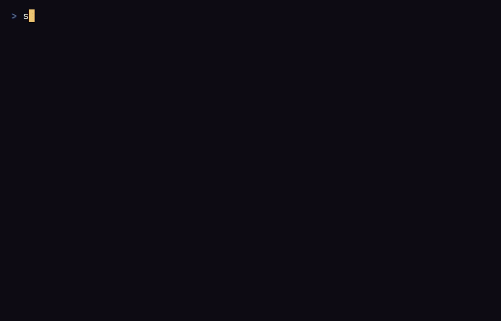

# Sigilfall

[English](README.md) · **Français**

[](https://github.com/Enzotekrennes/sigilfall/actions/workflows/ci.yml)

Un roguelike en terminal où l'on lance des sorts en traçant des sigilles sur
une grille de 3 × 3 avec les touches des chiffres, sur un clavier QWERTY
comme AZERTY : le motif décide du sort, les nouveaux motifs s'apprennent
sur des glyphes gravés dans le sol du donjon, et un tracé bâclé se dissipe
ou se retourne contre vous.

<!-- assets/demo.gif est enregistré à partir de demo.tape par le job `demo`
du workflow de CI (lancé à la main ou par un tag de version), puis commité
à la main. -->


Chaque trait d'un tracé prend du temps, et les monstres agissent pendant que
vous dessinez : un long sigille est un sort puissant, mais lent. Les premiers
étages sont des salles reliées par des couloirs ; plus bas, des grottes
naturelles les remplacent de plus en plus souvent, et le dixième étage en est
toujours une. Le dixième étage n'a pas d'escalier mais un sceau, `◎` sur la
carte (`0` en ASCII) : brisez-le pour gagner la partie. Chaque partie naît
d'une graine que vous pouvez partager, pour qu'un ami joue le même donjon, et
chaque jour apporte un donjon du jour, le même pour tous les joueurs de la
même version du jeu à cette date UTC. Tout le jeu est écrit en anglais et en
français : il parle la langue de votre système tant que vous n'en choisissez
pas une dans les options.

## Installation

Sigilfall tourne dans un terminal d'au moins 80 × 24 cellules, sous Windows,
Linux et macOS. Windows Terminal, ou tout terminal dont la police a les
caractères de dessin de cadres, l'affiche le mieux ; `--ascii` couvre les
autres.

**Binaires prêts à l'emploi.** Chaque [version](https://github.com/Enzotekrennes/sigilfall/releases)
propose des archives pour Windows (x86_64), Linux (x86_64, glibc) et macOS
(Intel et Apple Silicon), et deux installateurs qui téléchargent la bonne :

```sh
# Linux et macOS
curl --proto '=https' --tlsv1.2 -LsSf https://github.com/Enzotekrennes/sigilfall/releases/latest/download/sigilfall-installer.sh | sh
```

```powershell
# Windows (PowerShell)
powershell -ExecutionPolicy Bypass -c "irm https://github.com/Enzotekrennes/sigilfall/releases/latest/download/sigilfall-installer.ps1 | iex"
```

**Depuis les sources**, avec Rust 1.88 ou plus récent :

```sh
cargo install --locked --git https://github.com/Enzotekrennes/sigilfall sigilfall
```

## Jouer

```sh
sigilfall
```

L'écran titre propose **Continuer** (quand une partie est sauvegardée),
**Nouvelle partie**, **Graine** (tapez la graine de la nouvelle partie),
**Donjon du jour** (celui de la date UTC du jour, affichée à côté),
**Options** et **Quitter**. Une partie du jour affiche sa date dans la ligne
d'état à la place de la graine, et la garde une fois sauvegardée puis
reprise, même un autre jour.

### Ligne de commande

| Option | Effet |
|---|---|
| `--seed <SEED>` | Lance tout de suite une partie de cette graine, sans l'écran titre. La graine est un nombre comme `42`, ou la forme que le jeu affiche, comme `7F3A-91C2-0B5E-D4A8`. Refusé tant qu'une partie est sauvegardée, pour ne jamais la perdre : continuez-la, ou abandonnez-la depuis l'écran titre, d'abord. |
| `--daily` | Lance tout de suite le donjon du jour, sans l'écran titre : le même donjon pour tous les joueurs de la même version du jeu à la même date UTC, un nouveau chaque jour à minuit UTC. Incompatible avec `--seed`. Refusé tant qu'une partie est sauvegardée, comme `--seed`. |
| `--ascii` | Dessine avec de simples caractères ASCII au lieu des glyphes Unicode, pour cette session seulement, quoi que dise l'option Glyphes. |
| `--lang <LANG>` | Joue en `en` (anglais) ou en `fr` (français) pour cette session seulement, quoi que dise l'option Langue. |
| `--keyboard <LAYOUT>` | Prend les touches d'un clavier `qwerty` ou `azerty` pour cette session seulement, quoi que dise l'option Clavier. |
| `--help`, `--version` | Affiche l'aide ou la version. |

### Touches

Les touches suivent la disposition de clavier choisie dans les options,
QWERTY ou AZERTY (voir [Options](#options)), pour que se déplacer et tracer
ne demandent jamais Maj. Les deux dispositions partagent les flèches, le
pavé numérique (avec ou sans Verr Num), les chiffres et les touches vi
`h j k l y u b n` ; QWERTY y ajoute WASD, et AZERTY y ajoute ZQSD et la
rangée du haut tapée sans Maj, `& é " ' ( - è _ ç à`, qui vaut les chiffres
`1` à `0` partout où un chiffre compte (avec Maj, les mêmes touches donnent
les chiffres, qui marchent aussi).

Sur la carte :

| Action | QWERTY | AZERTY |
|---|---|---|
| Se déplacer d'une case, diagonales comprises ; aller sur un monstre l'attaque | Flèches, `w a s d`, `1`-`9` autour de `5` (pavé numérique ou rangée du haut), `h j k l y u b n` | Flèches, `z q s d`, `1`-`9` autour de `5` (pavé numérique, ou rangée du haut avec ou sans Maj : `& é " ' - è _ ç`), `h j k l y u b n` |
| Se déplacer en diagonale (le pavé numérique sans Verr Num) | Origine, Page préc., Fin, Page suiv. | Origine, Page préc., Fin, Page suiv. |
| Attendre un tour | `.`, `5`, centre du pavé | `.`, `5` ou `(`, centre du pavé |
| Ouvrir la grille pour tracer un sigille | `t` | `t` |
| Ramasser l'objet à ses pieds | `g`, `,` | `g`, `,` |
| Ouvrir l'inventaire | `i` | `i` |
| Descendre l'escalier, debout dessus ; au dixième étage, briser le sceau, debout dessus | `>`, `E` | `>`, `<`, `E` |
| Explorer : marcher vers l'endroit inexploré le plus proche, pas à pas (voir plus bas) | `x` | `x` |
| Sauvegarder et quitter | `q` | `p` |
| Quitter depuis n'importe quel écran, en sauvegardant la partie en cours | Ctrl+C | Ctrl+C |

En AZERTY, `q` et `d` déplacent : quitter passe donc sur `p`. Sur les deux
dispositions, la lettre qui descend l'escalier est `E` (« escalier ») : `d`
déplace vers l'est et `e` ne fait rien sur la carte, si bien que Verr Maj ne
change jamais un pas en descente. Échap ne quitte jamais : il ferme la grille, l'inventaire et les sous-écrans du titre,
et ne fait rien sur la carte. Aucune touche ne fait deux choses sur un même
écran d'une même disposition ; un test passe par toutes les touches de tous
les écrans pour que cela reste vrai.

Explorer avec `x` avance d'un pas à la fois, chacun un déplacement normal,
et s'arrête dès qu'un monstre entre en vue, qu'un objet ou un glyphe non lu
apparaît, que vous êtes blessé, qu'il ne reste rien à explorer, qu'une touche
est pressée, ou au bout de 200 pas ; le journal dit pourquoi. L'exploration
ne démarre pas avec un monstre en vue. L'aide des touches en bas de l'écran
nomme les lettres de votre disposition pour se déplacer et dit que quitter
sauvegarde la partie ; elle n'a pas la place pour les flèches, les chiffres,
les touches vi ni `x`, qui ne sont donc listés qu'ici.

Pendant le tracé d'un sigille, la grille est numérotée comme le pavé
numérique (7 8 9 en haut, 1 2 3 en bas) :

| Touches | Action |
|---|---|
| `1`-`9`, en AZERTY aussi la rangée du haut sans Maj (de `&` pour `1` à `ç` pour `9`), ou le pavé numérique avec ou sans Verr Num | Relier ce nœud au tracé |
| Retour arrière | Retirer le dernier nœud |
| Entrée | Lancer le tracé |
| Échap | Fermer la grille ; le temps ne passe pas |

Un sigille visé demande ensuite une direction : une touche de déplacement
vise, Échap revient au tracé. Après un sort instable ou raté, n'importe
quelle touche ferme le verdict.

Dans l'inventaire : Haut et Bas (ou `k` et `j`, `w` et `s` en QWERTY, `z` et
`s` en AZERTY), Origine et Fin, ou les chiffres `1`-`9` et `0` (en AZERTY,
aussi `&` à `à` sans Maj) choisissent un objet ; Entrée ou `u` l'utilise,
`d` le pose, Échap ferme l'inventaire.

Sur l'écran titre et la confirmation avant d'abandonner une partie
sauvegardée : Haut et Bas (ou `k` et `j`, `w` et `s` en QWERTY, `z` et `s` en
AZERTY), Origine et Fin, Entrée ; Échap revient de la confirmation, `q`
quitte depuis le titre (`p` en AZERTY). Pendant la saisie d'une graine :
Retour arrière efface, Entrée commence, Échap revient. Sur l'écran des
options : Haut et Bas (ou `k` et `j`, `w` et `s`, `z` et `s`) choisissent,
Gauche et Droite (ou `h` et `l`, `a` et `d` en QWERTY, `q` et `d` en AZERTY),
Entrée ou Espace changent la valeur, Échap revient. Après la mort, le
récapitulatif montre la graine de la partie et une ligne à copier et
partager, comme
`Sigilfall daily 2026-11-08 - depth 4, turn 812, 23 slain, 9 sigils` (ou
`Sigilfall seed 7F3A-91C2-0B5E-D4A8 - …` pour une partie d'une graine).
Briser le sceau ouvre l'écran de victoire, avec le même récapitulatif et une
ligne qui dit `victory` à la place de la profondeur, comme
`Sigilfall daily 2026-11-08 - victory, turn 4120, 96 slain, 31 sigils`.
Sur ces deux écrans, Entrée revient au titre, `q` quitte (`p` en AZERTY).
Pendant une seconde après la fin de la partie, seul Ctrl+C fonctionne, pour
qu'une touche déjà en route ne ferme pas le récapitulatif avant qu'on l'ait
vu.

### Les sigilles

Chaque partie commence avec Braise (`7 5 3`), un sort qui brûle l'ennemi le
plus proche. Les glyphes gravés dans le sol (`§`) enseignent les autres
sigilles quand vous marchez dessus, et le grimoire à côté de la grille liste
les motifs que vous connaissez. Un tracé qui reproduit exactement un motif
connu le lance ; à un nœud près, le sort part instable et un contrecoup
suit ; tout le reste se dissipe, et un motif qui ne ressemble à aucun de
ceux que vous connaissez est signalé comme absent de votre grimoire. Chaque
sort coûte 2 d'essence, qui revient lentement. Un sort prend un demi-tour,
plus un quart de tour par nœud relié, et les monstres continuent de bouger
pendant ce temps.

### Options

**Glyphes** (Unicode ou ASCII), **Couleurs** (Auto, 16 couleurs ou
Monochrome), **Thème** (sombre, ou clair pour les terminaux en couleurs
24 bits), **Langue** (English ou Français) et **Clavier** (QWERTY ou AZERTY)
s'appliquent tout de suite et sont gardées pour les sessions suivantes. Auto
suit le terminal et `NO_COLOR` ; 16 couleurs et Monochrome s'appliquent quoi
qu'ils disent. Tant que vous ne choisissez pas de langue, le jeu parle
français sur un système réglé en français, et anglais sinon. Tant que vous
ne choisissez pas de clavier, il prend AZERTY sur un système réglé en
français de France ou de Belgique, où les claviers AZERTY sont la norme, et
QWERTY sinon : la disposition elle-même ne peut pas être lue de façon sûre et
fiable sur tous les systèmes et dans tous les terminaux, alors le jeu la
devine d'après la langue et la région du système, et l'option la corrige.
La ligne à partager des écrans de fin reste en anglais, pour que les lignes
de deux joueurs se comparent quelle que soit leur langue ; `--help` est en
anglais, comme pour la plupart des outils en ligne de commande.

## Fichiers

Le jeu garde deux fichiers dans le dossier de données de votre système :

| Système | Dossier |
|---|---|
| Windows | `%APPDATA%\Sigilfall\data` |
| Linux | `$XDG_DATA_HOME/sigilfall`, par défaut `~/.local/share/sigilfall` |
| macOS | `~/Library/Application Support/Sigilfall` |

- `save.ron` contient la partie en cours. Il est écrit quand vous quittez,
  et supprimé quand vous mourez (la mort est définitive) ou brisez le sceau.
  Une sauvegarde illisible (abîmée, ou écrite par une autre version) est
  renommée `save.ron.bad`, l'écran titre dit pourquoi, et une nouvelle partie
  commence.
- `options.ron` contient les options. S'il est illisible, les options par
  défaut s'appliquent et le fichier est remplacé au prochain changement.

Les deux sont du texte RON lisible.

### Variables d'environnement

| Variable | Effet |
|---|---|
| `SIGILFALL_DATA_DIR` | Utilise ce dossier au lieu du dossier de données du système, pour la sauvegarde et les options. Créé s'il manque ; ignoré s'il est vide. |
| `NO_COLOR` | Quand elle a une valeur non vide et que **Couleurs** vaut Auto, dessine sans couleur ([no-color.org](https://no-color.org)). Choisir 16 couleurs dans les options passe avant elle. |
| `COLORTERM` | `truecolor` ou `24bit` active les couleurs 24 bits ; sinon les 16 couleurs ANSI sont utilisées, sauf dans Windows Terminal (reconnu à `WT_SESSION`), qui a les couleurs 24 bits. |

## Sous le capot

- **Des tours à l'énergie.** Chaque acteur gagne sa vitesse en énergie à
  chaque tic et agit dès qu'il en a 100 ; chaque action a son propre coût.
  Un monstre deux fois plus rapide que vous agit deux fois par pas que vous
  faites, et chaque nœud d'un sigille coûte du temps : un long tracé laisse
  aux monstres le temps d'agir.
- **Un flux aléatoire par usage.** Une partie est une graine de 64 bits ;
  chaque étage tire son type, son plan et ses combats de flux ChaCha8
  distincts, dérivés de (graine, profondeur, usage). Un étage ne dépend de
  rien de ce qui a été joué au-dessus, et la même graine donne le même donjon
  sur tous les systèmes.
- **Un champ de vision exact.** La vue est un shadowcasting symétrique où
  chaque pente est gardée comme une fraction de deux entiers : aucun arrondi,
  donc si vous voyez un monstre, il vous voit.
- **Les règles à part de l'écran.** La logique du jeu est une bibliothèque
  sans aucune dépendance au terminal, ce que le compilateur garantit ; elle
  renvoie des événements, et l'application en terminal les change en phrases
  et dessine.
- **Testé au-delà des exemples.** Des tests de propriétés génèrent des
  milliers de graines pour vérifier que chaque étage est d'un seul tenant et
  que la vue est symétrique ; des règles ont été cassées exprès pour vérifier
  que les tests le voient ; deux bots, un téméraire et un prudent, jouent
  80 parties chacun pour tenir la difficulté dans sa cible.
- **Des sauvegardes qui rejouent à l'identique.** Une sauvegarde garde les
  flux aléatoires et l'ordre dans lequel les clés d'entités libérées sont
  réutilisées : une partie reprise se déroule exactement comme sans avoir
  quitté, et chaque valeur relue est vérifiée avant qu'on s'y fie.

[ARCHITECTURE.md](ARCHITECTURE.md) (en anglais) détaille les modules, les
flux et les décisions de conception.

## Compiler et tester

```sh
cargo build --release --locked          # target/release/sigilfall
cargo test --workspace --locked
cargo clippy --workspace --all-targets --locked -- -D warnings
cargo clippy --workspace --locked -- -D warnings   # le code livré seul
cargo fmt --all --check
RUSTDOCFLAGS="-D warnings" cargo doc --workspace --no-deps --locked
```

La chaîne d'outils est fixée sur stable par `rust-toolchain.toml` ; la
version minimale prise en charge est Rust 1.88. La CI lance ces vérifications
sous Linux, Windows et macOS, et vérifie la compilation avec Rust 1.88.

Le GIF de démonstration est enregistré à partir de [`demo.tape`](demo.tape)
avec [VHS](https://github.com/charmbracelet/vhs) par le job `demo` du
workflow de CI, lancé à la main ou sur un tag de version ; le test
`app::tests::demo_tape` rejoue ses touches pour vérifier que la partie
enregistrée lit toujours un glyphe, lance un sort, combat et descend
l'escalier.

Les versions sont construites par [`dist`](https://github.com/axodotdev/cargo-dist)
à partir de `dist-workspace.toml` : pousser un tag comme `v0.1.0` construit
les binaires et les installateurs, et les publie comme version GitHub.

## Documentation

- [ARCHITECTURE.md](ARCHITECTURE.md) (en anglais) : les deux crates, leurs
  modules, comment une touche devient un tour, l'identité visuelle, et les
  décisions de conception avec les solutions écartées.

## Licence

Sous licence, au choix :

- Apache License, Version 2.0 ([LICENSE-APACHE](LICENSE-APACHE))
- licence MIT ([LICENSE-MIT](LICENSE-MIT))

Sauf mention contraire explicite de votre part, toute contribution soumise
intentionnellement pour être incluse dans l'œuvre, au sens de la licence
Apache-2.0, sera placée sous la double licence ci-dessus, sans aucune
condition supplémentaire.
