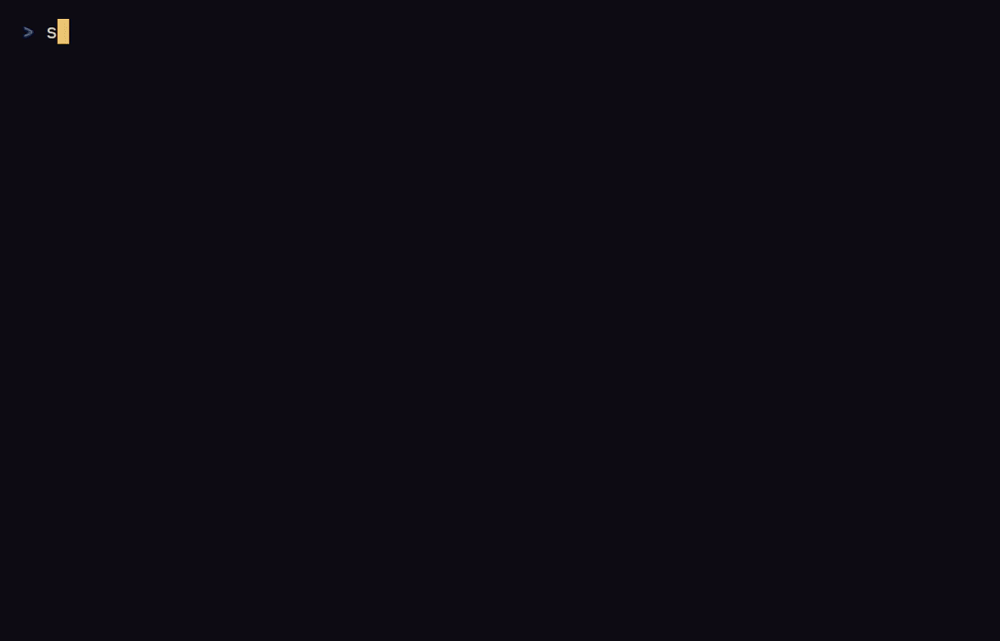

# Sigilfall

A terminal roguelike where spells are cast by tracing sigils on a 3 × 3 grid
with the number keys: the pattern decides the spell, new patterns are learnt
from glyphs carved in the dungeon floor, and a sloppy trace fizzles or
backfires.

<!-- assets/demo.gif is recorded from demo.tape by the `demo` job of the CI
workflow (run it by hand or push a version tag), then committed by hand. -->


Every stroke of a trace costs time, and the monsters act while you draw:
a long sigil is a strong spell, but a slow one. Each run is generated from a
seed you can share, so a friend can play the same dungeon, and every day
brings a daily dungeon, the same for every player on that UTC date.

## Install

Sigilfall runs in a terminal of at least 80 × 24 cells, on Windows, Linux
and macOS. Windows Terminal, or any terminal with a font that has box
drawing characters, shows it best; `--ascii` covers the others.

**Prebuilt binaries.** Each [release](https://github.com/OWNER/sigilfall/releases)
has archives for Windows (x86_64), Linux (x86_64, glibc) and macOS (Intel and
Apple Silicon), and two installers that download the right one:

```sh
# Linux and macOS
curl --proto '=https' --tlsv1.2 -LsSf https://github.com/OWNER/sigilfall/releases/latest/download/sigilfall-installer.sh | sh
```

```powershell
# Windows (PowerShell)
powershell -ExecutionPolicy Bypass -c "irm https://github.com/OWNER/sigilfall/releases/latest/download/sigilfall-installer.ps1 | iex"
```

**From source**, with Rust 1.88 or later:

```sh
cargo install --locked --git https://github.com/OWNER/sigilfall sigilfall
```

After the crates.io release, `cargo install sigilfall` will work too.

## Play

```sh
sigilfall
```

The title screen offers **Continue** (when a game is saved), **New game**,
**Seed** (type the seed of the new game), **Daily** (the daily dungeon of
today's UTC date, shown beside it), **Options** and **Quit**. A daily run
shows its date on the status line instead of the seed, and keeps it when
saved and resumed, even on a later day.

### Command line

| Option | Effect |
|---|---|
| `--seed <SEED>` | Start a game of this seed at once, without the title screen. The seed is a number such as `42`, or the form the game shows, such as `7F3A-91C2-0B5E-D4A8`. Refused while a game is saved, so that game is never lost: continue it, or abandon it from the title screen, first. |
| `--daily` | Start the daily dungeon at once, without the title screen: the same dungeon for every player on the same UTC date, a new one each day at midnight UTC. Cannot be combined with `--seed`. Refused while a game is saved, as `--seed` is. |
| `--ascii` | Draw with plain ASCII characters instead of Unicode glyphs, for this session only, whatever the Glyphs option says. |
| `--help`, `--version` | Print the help or the version. |

### Keys

On the map:

| Keys | Action |
|---|---|
| Arrows, `1`-`9` around `5` (keypad or top row), `h j k l y u b n` | Move one cell, diagonals included; moving into a monster attacks it |
| Home, Page Up, End, Page Down | Move diagonally (the keypad without Num Lock) |
| `.`, `5`, keypad centre | Wait a turn |
| `t` | Open the sigil grid to trace a sigil |
| `g`, `,` | Pick up the item underfoot |
| `i` | Open the inventory |
| `>`, `D` | Go down the stairs, when standing on them |
| `q` | Save and quit |
| Ctrl+C | Quit from any screen, saving the game in progress |

Escape never quits: it closes the grid, the inventory and the sub-screens of
the title, and does nothing on the map.

While tracing a sigil, the grid is numbered like the keypad (7 8 9 on top,
1 2 3 at the bottom):

| Keys | Action |
|---|---|
| `1`-`9`, or the keypad with or without Num Lock | Link that node to the trace |
| Backspace | Remove the last node |
| Enter | Cast the trace |
| Escape | Close the grid; no time passes |

A sigil aimed in a direction then asks for one: a movement key aims, Escape
goes back to the trace. After an unstable or failed cast, any key closes the
verdict.

In the inventory: Up and Down (or `k` and `j`), Home and End, or the digits
`1`-`9` and `0` choose an item; Enter or `u` uses it, `d` drops it, Escape
closes the inventory.

On the title screen and the confirmation before abandoning a saved game: Up
and Down (or `k` and `j`), Home and End, Enter; Escape goes back from the
confirmation, `q` quits from the title. While typing a seed: Backspace
erases, Enter starts, Escape goes back. On the options screen: Up and Down
(or `k` and `j`) choose, Left and Right (or `h` and `l`), Enter or Space
change the value, Escape goes back. After death, the summary shows the seed
of the run and a line to copy and share, such as
`Sigilfall daily 2026-11-08 - depth 4, turn 812, 23 slain, 9 sigils` (or
`Sigilfall seed 7F3A-91C2-0B5E-D4A8 - …` for a run of a seed); Enter goes
back to the title, `q` quits. For one second after
the death only Ctrl+C works, so a key already on its way does not close the
summary unseen.

### How sigils work

Glyphs carved in the floor (`§`) teach a sigil when you step on them, and
the grimoire beside the grid lists the patterns you know. A trace that
matches a known pattern exactly casts it; one node off, the spell goes off
unstable and a backlash follows; anything else fizzles. Every cast spends
2 essence, which comes back slowly. A cast takes half a turn plus a quarter
of a turn for each node linked, and the monsters keep moving meanwhile.

### Options

**Glyphs** (Unicode or ASCII), **Colours** (automatic, 16 colours or none)
and **Theme** (dark, or light for 24-bit colour terminals) apply at once and
are kept for the next sessions.

## Files

The game keeps two files in the data folder of your system:

| System | Folder |
|---|---|
| Windows | `%APPDATA%\Sigilfall\data` |
| Linux | `$XDG_DATA_HOME/sigilfall`, by default `~/.local/share/sigilfall` |
| macOS | `~/Library/Application Support/Sigilfall` |

- `save.ron` holds the game in progress. It is written when you quit and
  deleted when you die: death is final. A save that cannot be read back
  (damaged, or written by another version) is renamed `save.ron.bad`, the
  title screen says why, and a new game starts.
- `options.ron` holds the options. If it cannot be read, the default
  options are used and the file is replaced at the next change.

Both are readable RON text.

### Environment variables

| Variable | Effect |
|---|---|
| `SIGILFALL_DATA_DIR` | Use this folder instead of the system's data folder, for the save and the options. Created if missing; ignored when empty. |
| `NO_COLOR` | When set to a non-empty value, draw without colour ([no-color.org](https://no-color.org)). |
| `COLORTERM` | `truecolor` or `24bit` turns on 24-bit colour; otherwise the 16 ANSI colours are used, except in Windows Terminal (detected by `WT_SESSION`), which gets 24-bit colour. |

## Build and test

```sh
cargo build --release --locked          # target/release/sigilfall
cargo test --workspace --locked
cargo clippy --workspace --all-targets --locked -- -D warnings
cargo fmt --all --check
RUSTDOCFLAGS="-D warnings" cargo doc --workspace --no-deps --locked
```

The toolchain is pinned to stable by `rust-toolchain.toml`; the minimum
supported version is Rust 1.88. CI runs these checks on Linux, Windows and
macOS, and checks the build on Rust 1.88.

The demo GIF is recorded from [`demo.tape`](demo.tape) with
[VHS](https://github.com/charmbracelet/vhs) by the `demo` job of the CI
workflow, run by hand or on a version tag; the test
`app::tests::demo_tape` replays its keys to check that the recorded run
still reads a glyph, casts, fights and goes down the stairs.

Releases are built by [`dist`](https://github.com/axodotdev/cargo-dist) from
`dist-workspace.toml`: pushing a tag such as `v0.1.0` builds the binaries and
installers and publishes them as a GitHub release.

## Documentation

- [ARCHITECTURE.md](ARCHITECTURE.md): the two crates, their modules, how a
  key press becomes a turn, and the design decisions with the alternatives
  set aside.
- [Documentation site](https://OWNER.github.io/sigilfall/), in English and
  French.

## License

Licensed under either of

- Apache License, Version 2.0 ([LICENSE-APACHE](LICENSE-APACHE))
- MIT license ([LICENSE-MIT](LICENSE-MIT))

at your option.

Unless you explicitly state otherwise, any contribution intentionally submitted
for inclusion in the work by you, as defined in the Apache-2.0 license, shall be
dual licensed as above, without any additional terms or conditions.
