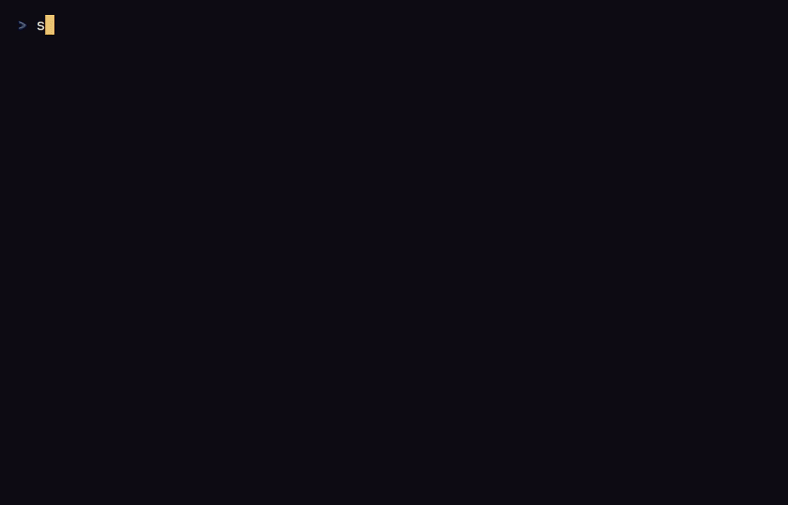

## Le jeu

Le motif que vous tracez décide du sort. Les nouveaux motifs s'apprennent
sur des glyphes gravés dans le sol du donjon, et un tracé bâclé se dissipe
ou se retourne contre vous.

Chaque trait d'un tracé prend du temps, et les monstres agissent pendant que
vous dessinez : un long sigille est un sort puissant, mais lent.

Les premiers étages sont des salles reliées par des couloirs. Plus bas, des
grottes naturelles les remplacent de plus en plus souvent, et le dixième
étage en est toujours une. Le dixième étage n'a pas d'escalier mais un
sceau, `◎` sur la carte (`0` en ASCII) : brisez-le pour gagner la partie.

Chaque partie naît d'une graine que vous pouvez partager, pour qu'un ami
joue le même donjon. Chaque jour apporte un donjon du jour, le même pour tous
les joueurs de la même version du jeu à cette date UTC.

Tout le jeu est écrit en anglais et en français. Il parle la langue de votre
système tant que vous n'en choisissez pas une dans les options.

## Pour aller plus loin

- [Installer](/sigilfall/fr/install/) le jeu depuis une version publiée ou
  depuis les sources.
- [Comment jouer](/sigilfall/fr/play/) : se déplacer, combattre, tracer des
  sigilles, descendre, sauvegarder.
- [Dispositions de clavier](/sigilfall/fr/keyboard/) : les touches en QWERTY
  et en AZERTY.
- [Langue](/sigilfall/fr/language/) : anglais ou français.
- [Fichiers et options](/sigilfall/fr/files/) : où le jeu garde sa
  sauvegarde et ses options.
- [Architecture](/sigilfall/fr/architecture/) et
  [Contribuer](/sigilfall/fr/contributing/), pour lire ou modifier le code.

Sigilfall est sous licence MIT ou Apache 2.0, au choix. Le code source est
sur [GitHub](https://github.com/Enzotekrennes/sigilfall).
