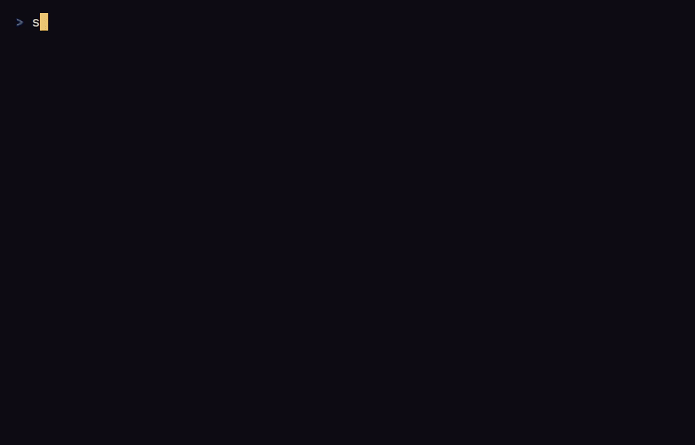

## The game

The pattern you trace decides the spell. New patterns are learnt from glyphs
carved in the dungeon floor, and a sloppy trace fizzles or backfires.

Every stroke of a trace costs time, and the monsters act while you draw: a
long sigil is a strong spell, but a slow one.

The first floors are rooms joined by corridors. Deeper down, natural caves
take their place more and more often, and the tenth floor is always one. The
tenth floor has no stairs but a seal, `◎` on the map (`0` in ASCII): break it
to win the run.

Each run is generated from a seed you can share, so a friend can play the
same dungeon. Every day brings a daily dungeon, the same for every player of
the same version of the game on that UTC date.

The whole game is written in English and in French. It speaks the language
of your system until you choose one in the options.

## Where to go next

- [Install](/sigilfall/install/) the game from a release or from source.
- [How to play](/sigilfall/play/): moving, fighting, tracing sigils, going
  down, saving.
- [Keyboard layouts](/sigilfall/keyboard/): the keys on QWERTY and AZERTY.
- [Language](/sigilfall/language/): English or French.
- [Files and options](/sigilfall/files/): where the game keeps its save and
  options.
- [Architecture](/sigilfall/architecture/) and
  [Contributing](/sigilfall/contributing/), to read or change the code.

Sigilfall is licensed under either of the MIT license or the Apache License,
Version 2.0, at your option. The source code is on
[GitHub](https://github.com/Enzotekrennes/sigilfall).
